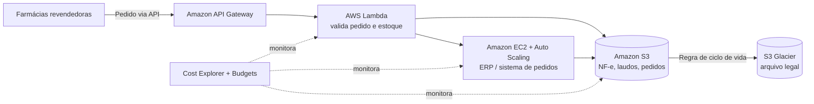

# ☁️ Abstergo Industries — Redução de Custos com AWS


Projeto de consultoria em nuvem para a **Abstergo Industries**, uma distribuidora farmacêutica que funciona como hub entre fabricantes e farmácias revendedoras e que ainda não tinha nenhum serviço em nuvem.

O gestor financeiro perguntou: **"o que pode ser feito para reduzir custos?"**. A resposta foi escolher três serviços AWS, explicar em linguagem de negócio como cada um corta gastos e qual é o principal ganho para a empresa.

📄 **Relatório completo:** [RELATORIO.md](RELATORIO.md)

---

## 🎯 Problema

| Situação atual (on-premises) | Impacto financeiro |
|---|---|
| Servidores próprios dimensionados "pelo pico" | Capacidade ociosa paga o ano inteiro |
| Storage e backup em equipamentos locais | Compra, manutenção, espaço físico e risco de perda |
| Integração manual com as farmácias | Horas de trabalho repetitivo e erros em pedidos |
| Energia, refrigeração e renovação de hardware | Gasto fixo (CAPEX) que não acompanha a receita |

## 💡 Solução proposta

| Etapa | Serviço | O que resolve | Principal ganho |
|---|---|---|---|
| 1 | **Amazon EC2 + Auto Scaling** | Substitui os servidores físicos (ERP, pedidos, portal das farmácias) | Paga só pela capacidade usada, sem servidor parado |
| 2 | **Amazon S3 + Glacier** | Notas fiscais, laudos, rastreabilidade de lotes e backups | Arquivo histórico obrigatório na faixa de preço mais baixa |
| 3 | **AWS Lambda** | Automação da integração com as farmácias revendedoras | Custo proporcional ao volume de pedidos |

**Governança de custos:** AWS Cost Explorer + AWS Budgets, para o financeiro acompanhar gastos por serviço e receber alertas de orçamento.

## 🏗️ Arquitetura



Detalhes em [docs/arquitetura.md](docs/arquitetura.md).

## 📁 Estrutura do repositório

```
abstergo-aws-cost-optimization/
├── README.md                          ← você está aqui
├── RELATORIO.md                       ← relatório de implementação (entregável principal)
├── docs/
│   ├── arquitetura.md                 ← diagrama e fluxo da solução
│   └── glossario-para-o-financeiro.md ← termos de cloud explicados sem jargão
├── anexos/
│   ├── estimativa-custos.csv          ← modelo comparativo on-premises x AWS
│   ├── cronograma-migracao.md         ← plano de migração por etapa
│   ├── inventario-servidores.csv      ← modelo de levantamento da infraestrutura atual
│   └── links-referencia.md            ← documentação oficial e calculadora AWS
└── LICENSE
```

## 🧠 Competências demonstradas

- Levantamento de cenário e tradução de necessidades de negócio em solução técnica
- Seleção de serviços AWS com foco em **FinOps** (otimização de custos em nuvem)
- Comunicação técnica para público não técnico (gestor financeiro)
- Modelo de pagamento CAPEX → OPEX, Savings Plans e classes de armazenamento
- Documentação em Markdown e diagramas como código (Mermaid)

## 🔗 Links úteis

- [AWS Pricing Calculator](https://calculator.aws/)
- [Amazon EC2](https://aws.amazon.com/pt/ec2/) · [Amazon S3](https://aws.amazon.com/pt/s3/) · [AWS Lambda](https://aws.amazon.com/pt/lambda/)
- [AWS Cost Explorer](https://aws.amazon.com/pt/aws-cost-management/aws-cost-explorer/)

## 👤 Autor

**Oscar do Carmo Junior**
📧 oscarmojunior@gmail.com

---

> Projeto acadêmico/de portfólio. A Abstergo Industries é uma empresa fictícia e os valores da estimativa de custos são ilustrativos — para uma proposta real, use a AWS Pricing Calculator com os dados do inventário.
