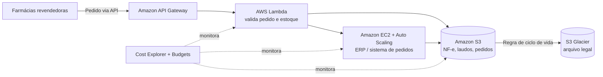

# Arquitetura da solução

## Fluxo de um pedido

1. A farmácia revendedora envia o pedido pelo portal ou por API.
2. O **API Gateway** recebe a requisição e aciona uma função **Lambda**.
3. A Lambda valida o pedido, consulta o estoque no sistema que roda no **EC2** e devolve a confirmação.
4. A nota fiscal (XML/PDF) e o comprovante do pedido são gravados no **S3**.
5. Após o prazo definido (ex.: 90 dias), uma **regra de ciclo de vida** move os documentos para o **S3 Glacier**, onde ficam pelo período exigido pela legislação fiscal e sanitária.
6. O **Auto Scaling** adiciona instâncias EC2 nos picos (início da manhã, fim do mês) e remove quando a demanda cai.
7. **Cost Explorer** e **Budgets** acompanham o gasto de cada serviço e alertam o financeiro se o orçamento mensal for ultrapassado.

## Por que essas escolhas

| Decisão | Motivo |
|---|---|
| EC2 em vez de servidores próprios | Elimina compra e renovação de hardware; capacidade elástica |
| Savings Plans para a carga fixa | Desconto em troca de compromisso de 1 ou 3 anos |
| S3 Intelligent-Tiering | Move automaticamente arquivos pouco acessados para faixas mais baratas |
| Glacier para arquivo legal | Documentos raramente consultados, mas que precisam ser guardados por anos |
| Lambda para integrações | Cobra por execução; nenhum servidor ligado esperando pedidos |
